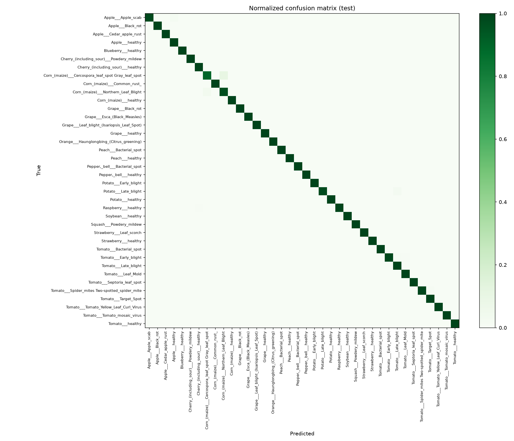

# 🌿 LeafScan

**Plant disease detection from leaf photos — and, later, a RAG assistant that explains how to treat it.**

[](https://github.com/marconcini/leafscan/actions/workflows/ci.yml)


> 🚧 Work in progress — built step by step, see the [roadmap](#roadmap).

## Overview

LeafScan is an end-to-end applied AI project built in two phases:

1. **Vision** — fine-tune pretrained image models (CNNs and Vision Transformers) to recognise
   **38 crop/disease classes** from a single leaf photo, compare them rigorously, and explain
   predictions with Grad-CAM.
2. **RAG** — given the detected disease, answer the user's questions ("how do I treat it?",
   "is it contagious?") from a curated corpus of agronomic fact sheets, **citing sources**, with
   a proper evaluation of retrieval quality and hallucinations.

## Data

[PlantVillage](https://github.com/spMohanty/PlantVillage-Dataset) (color version, CC BY-SA 3.0):
54,305 leaf images, 14 crops, 38 classes, loaded from the
[Hugging Face Hub](https://huggingface.co/datasets/mohanty/PlantVillage).

**Avoiding data leakage.** Each physical leaf was photographed ~4 times. A naive random split puts
photos of the *same leaf* in both train and validation, which inflates scores. LeafScan:

- uses the **official test split** (10,709 images) for final results only;
- builds the validation set with a **group split by physical leaf**, using the dataset's
  `leaf-map.json` (0 leaves shared between train and validation, checked by a unit test).

| Split | Images |
|---|---|
| Train | 39,251 |
| Validation | 4,345 |
| Test (official) | 10,709 |

## Results

Official PlantVillage test split (10,709 images, never used for model selection).

| Model | Params | Accuracy | Macro-F1 | Top-5 | Train time (Apple M-series, MPS) |
|---|---|---|---|---|---|
| EfficientNet-B0 | 5.3M | **99.65%** | **99.46%** | 99.99% | 21 min (5 epochs) |

- 38 errors out of 10,709. Almost half (18) are between two **corn** diseases, *Cercospora / gray
  leaf spot* and *Northern leaf blight*, which both form elongated lesions on the leaf.
- 5 errors confuse **potato late blight** with **tomato late blight**: same disease, same
  pathogen (*Phytophthora infestans*), wrong crop.
- Wrong predictions are much less confident (0.64 on average vs 0.89 for correct ones), which
  suggests a confidence threshold could flag uncertain diagnoses.

Details: [`reports/efficientnet_b0/`](reports/efficientnet_b0) · analysis in the
[research log](docs/research-log.md).



> These scores are on lab images with uniform backgrounds. How they hold up on real field photos
> is one of the next questions on the [roadmap](ROADMAP.md).

## Quickstart

```bash
python -m venv .venv && source .venv/bin/activate
pip install -e ".[dev]"

python scripts/download_data.py                      # ~2.2 GB download, color images only kept
python -m leafscan.train --config configs/efficientnet_b0.yaml
python -m leafscan.evaluate models/efficientnet_b0/best.pt
```

Quick sanity run (a few minutes): `python -m leafscan.train --config configs/efficientnet_b0.yaml --limit-per-class 20 --epochs 1`

Training runs on CUDA, Apple Silicon (MPS) or CPU.

## Project structure

```
src/leafscan/
├── data.py       # download, leak-free splits, dataset & augmentations
├── model.py      # timm backbones, device selection, checkpoints
├── train.py      # fine-tuning loop (AdamW, warmup + cosine, label smoothing)
└── evaluate.py   # accuracy, macro-F1, top-5, per-class report, confusion matrix
configs/          # one YAML per compared model
tests/            # unit tests + end-to-end pipeline test on a synthetic dataset
```

## Roadmap

Detailed plan with research questions: [ROADMAP.md](ROADMAP.md) · experiment journal: [docs/research-log.md](docs/research-log.md) · papers: [docs/references.md](docs/references.md)

**Phase 1 — Vision**
- [x] Data pipeline with leak-free validation split
- [x] Training & evaluation pipeline, tests, CI
- [x] Baseline: EfficientNet-B0 (99.65% test accuracy)
- [ ] Model comparison: ResNet-50 · ConvNeXt-T · ViT-S (accuracy, F1, latency, size)
- [ ] Error analysis + Grad-CAM explanations
- [ ] Robustness to real field photos (lab → field domain shift)
- [ ] Gradio demo on Hugging Face Spaces

**Phase 2 — RAG assistant**
- [ ] Corpus of agronomic fact sheets per disease
- [ ] Retrieval pipeline (embeddings + vector store) and grounded generation with citations
- [ ] Evaluation: test question set, retrieval metrics, faithfulness / hallucination rate
- [ ] Full app: photo → diagnosis → Q&A

## License

Code: MIT. Dataset: PlantVillage, CC BY-SA 3.0.
