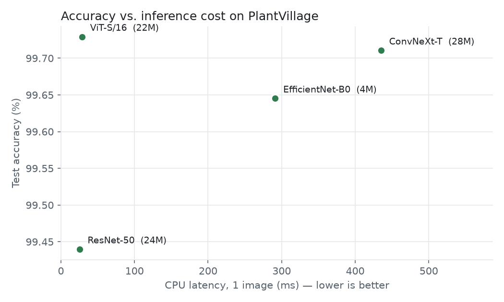
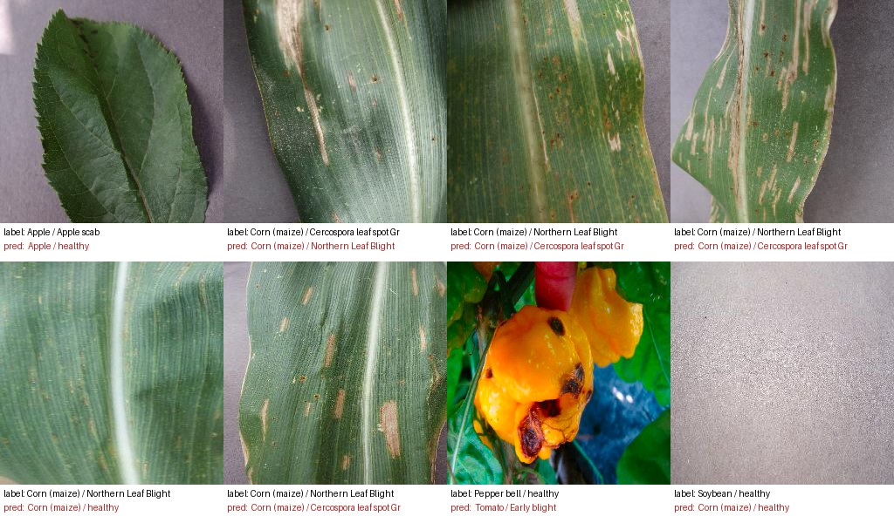
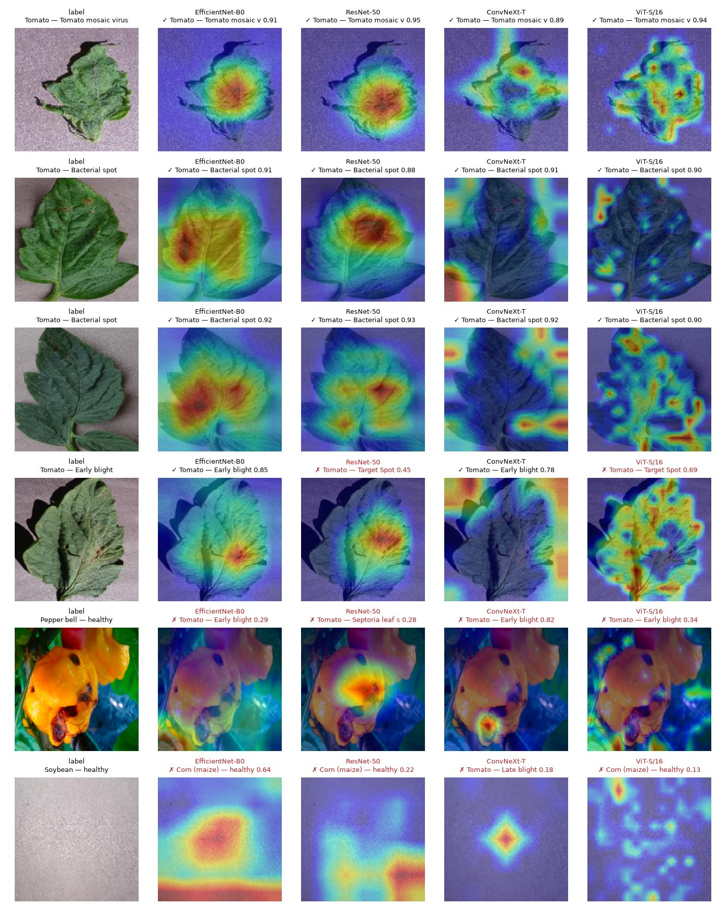
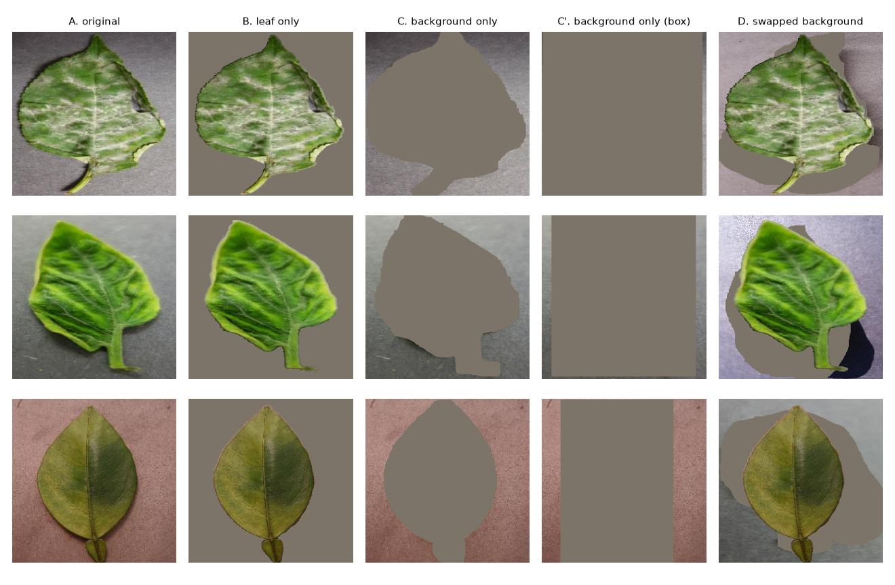

# 🌿 LeafScan

**Plant disease detection from leaf photos — and, later, a RAG assistant that explains how to treat it.**

[](https://github.com/marconcini/leafscan/actions/workflows/ci.yml)


> 🚧 Work in progress — built step by step, see the [roadmap](#roadmap).

## Overview

LeafScan is an end-to-end applied AI project built in two phases:

1. **Vision** — fine-tune pretrained image models (CNNs and Vision Transformers) to recognise
   **38 crop/disease classes** from a single leaf photo, compare them rigorously, and explain
   predictions with Grad-CAM.
2. **RAG** — given the detected disease, answer the user's questions ("how do I treat it?",
   "is it contagious?") from a curated corpus of agronomic fact sheets, **citing sources**, with
   a proper evaluation of retrieval quality and hallucinations.

## Data

[PlantVillage](https://github.com/spMohanty/PlantVillage-Dataset) (color version, CC BY-SA 3.0):
54,305 leaf images, 14 crops, 38 classes, loaded from the
[Hugging Face Hub](https://huggingface.co/datasets/mohanty/PlantVillage).

**Avoiding data leakage.** Each physical leaf was photographed ~4 times. A naive random split puts
photos of the *same leaf* in both train and validation, which inflates scores. LeafScan:

- uses the **official test split** (10,709 images) for final results only;
- builds the validation set with a **group split by physical leaf**, using the dataset's
  `leaf-map.json` (0 leaves shared between train and validation, checked by a unit test).

| Split | Images |
|---|---|
| Train | 39,251 |
| Validation | 4,345 |
| Test (official) | 10,709 |

## Results

Official PlantVillage test split (10,709 images, never used for model selection).
Same recipe for every model (5 epochs, batch 64, same augmentations and seed; only the
learning rate differs). Latency: 1 image on an Apple M-series CPU; throughput: batch 64 on its GPU (MPS).

| Model | Params | GFLOPs | Size | Accuracy | Macro-F1 | Errors | CPU latency | GPU throughput |
|---|---:|---:|---:|---:|---:|---:|---:|---:|
| EfficientNet-B0 | 4.1M | 0.8 | 16 MB | 99.65% | 99.46% | 38 | 291 ms | 664 img/s |
| ViT-S/16 | 21.7M | 8.5 | 83 MB | **99.73%** | 99.59% | 29 | 29 ms | 810 img/s |
| ResNet-50 | 23.6M | 8.2 | 90 MB | 99.44% | 99.20% | 60 | 25 ms | 570 img/s |
| ConvNeXt-T | 27.8M | 8.9 | 106 MB | 99.71% | 99.55% | 31 | 435 ms | 420 img/s |

**Takeaways**

- **Architecture barely matters on lab images.** All four models are within 0.3 points.
  An exact McNemar test finds **no significant difference between ViT-S, ConvNeXt-T and
  EfficientNet-B0** (p > 0.18); only ResNet-50 is significantly worse (p < 0.004, still
  significant after Bonferroni correction).
- **Fewer FLOPs ≠ faster.** EfficientNet-B0 needs 10× fewer FLOPs than ResNet-50 but is 11×
  slower on this CPU: the PyTorch macOS build has no oneDNN, and the depthwise convolutions
  used by EfficientNet and ConvNeXt fall back to slow kernels. ViT-S is the most accurate *and*
  among the fastest here.
- **Models fail on different images** (pairwise Jaccard overlap of errors 0.17–0.41): 94 images
  fooled at least one model, only 8 fooled all four. Among those 8, two are **dataset errors**
  (a photo of rotten pepper *fruits* labelled "healthy pepper leaf", an empty background labelled
  "healthy soybean") and five are corn leaves with ambiguous lesions.



<sub>Y-axis zoomed: the whole range is 0.3 points.</sub>

Images misclassified by all four models (label / most frequent prediction):



### Where do the models look?

Grad-CAM on the whole test set, compared with leaf masks taken from PlantVillage's
background-removed images. *Leaf focus* = share of the Grad-CAM mass on the leaf
(leaf area = 56.5% on average); *pointing game* = the map's maximum is on the leaf.

| Model | Leaf focus | Pointing game | Random weights (focus / pointing) |
|---|---:|---:|---:|
| ResNet-50 | 88.2% | 98.8% | 58.5% / 44.8% |
| EfficientNet-B0 | 77.1% | 95.6% | 63.7% / 80.4% |
| ConvNeXt-T | 73.9% | 88.7% | 54.9% / 46.7% |
| ViT-S/16 | 68.8% | 67.9% | 35.3% / 32.2% |

- All models mostly look at the leaf, but 12–31% of the attention lands on the background.
- **The most accurate models look the least at the leaf.** On tomato bacterial spot, ConvNeXt-T
  often focuses on the background, yet gets all 436 test images right — a possible shortcut —
  which the causal test below rules out.
- The random-weights baseline [Adebayo et al. 2018] matters: an *untrained* EfficientNet-B0
  already points at the leaf 80% of the time.



### Do they *use* the background? A causal test

Grad-CAM only shows where the map is hot. To test whether the background changes the
prediction, test images are edited with the leaf masks (balanced accuracy, chance = 2.6%):



| Model | Original | Leaf only | Background only (box) | Swapped background: follows leaf / background |
|---|---:|---:|---:|---:|
| ViT-S/16 | 99.6% | **97.7%** | 3.3% | 96.6% / 0.3% |
| ResNet-50 | 99.1% | 95.8% | 3.0% | 97.6% / 0.2% |
| ConvNeXt-T | 99.5% | 94.6% | 4.8% | 97.1% / 0.4% |
| EfficientNet-B0 | 99.4% | 84.5% | 1.4% | 91.6% / 1.3% |

- **No model really uses the background**: background-only images are at chance level, and with
  a swapped background, predictions follow the leaf. The Grad-CAM suspicion about ConvNeXt-T and
  ViT-S was a false alarm.
- **Two artefacts almost said the opposite**: the grey hole revealed the leaf *silhouette* (ViT-S
  20% → 0.7% once hidden), and on blank images models answer one default class (ResNet-50 looked
  like 10.8% "accurate" this way).
- EfficientNet-B0 is the most **disturbed** by a changed background (−15 points), without
  following it: a robustness issue to keep in mind for real field photos.

Details per model in [`reports/`](reports) · full analysis in the [research log](docs/research-log.md).

> These scores are on lab images with uniform backgrounds. How they hold up on real field photos
> is one of the next questions on the [roadmap](ROADMAP.md).

## Quickstart

```bash
python -m venv .venv && source .venv/bin/activate
pip install -e ".[dev]"

python scripts/download_data.py                      # ~2.2 GB download, color images only kept
python -m leafscan.train --config configs/efficientnet_b0.yaml
python -m leafscan.evaluate models/efficientnet_b0/best.pt
python -m leafscan.benchmark models/*/best.pt         # run on an idle machine
python -m leafscan.compare                             # -> reports/comparison.md / .png

python scripts/download_data.py --segmented           # leaf masks for Grad-CAM
python -m leafscan.explain metrics models/resnet50/best.pt [--random-weights]
python -m leafscan.explain figure models/*/best.pt --images  ... --device cpu
python -m leafscan.background models/convnext_tiny/best.pt
```

Quick sanity run (a few minutes): `python -m leafscan.train --config configs/efficientnet_b0.yaml --limit-per-class 20 --epochs 1`

Training runs on CUDA, Apple Silicon (MPS) or CPU.

## Project structure

```
src/leafscan/
├── data.py       # download, leak-free splits, dataset & augmentations
├── model.py      # timm backbones, device selection, checkpoints
├── train.py      # fine-tuning loop (AdamW, warmup + cosine, label smoothing)
├── evaluate.py   # accuracy, macro-F1, top-5, per-class report, confusion matrix, errors
├── benchmark.py  # params, FLOPs, size, CPU latency, GPU throughput
├── compare.py    # comparison table & plot, error overlap, McNemar tests
├── gradcam.py    # Grad-CAM for CNNs and ViT, leaf-focus & pointing-game metrics
├── explain.py    # Grad-CAM analysis against leaf masks, example figures
└── background.py # causal test: leaf only, background only, swapped background
configs/          # one YAML per compared model
tests/            # unit tests + end-to-end pipeline test on a synthetic dataset
```

## Roadmap

Detailed plan with research questions: [ROADMAP.md](ROADMAP.md) · experiment journal: [docs/research-log.md](docs/research-log.md) · papers: [docs/references.md](docs/references.md)

**Phase 1 — Vision**
- [x] Data pipeline with leak-free validation split
- [x] Training & evaluation pipeline, tests, CI
- [x] Baseline: EfficientNet-B0 (99.65% test accuracy)
- [x] Model comparison: ResNet-50 · ConvNeXt-T · ViT-S (accuracy, F1, latency, size)
- [x] Error analysis + Grad-CAM explanations
- [x] Background bias: causal test with edited backgrounds
- [ ] Robustness to real field photos (lab → field domain shift)
- [ ] Gradio demo on Hugging Face Spaces

**Phase 2 — RAG assistant**
- [ ] Corpus of agronomic fact sheets per disease
- [ ] Retrieval pipeline (embeddings + vector store) and grounded generation with citations
- [ ] Evaluation: test question set, retrieval metrics, faithfulness / hallucination rate
- [ ] Full app: photo → diagnosis → Q&A

## License

Code: MIT. Dataset: PlantVillage, CC BY-SA 3.0.
