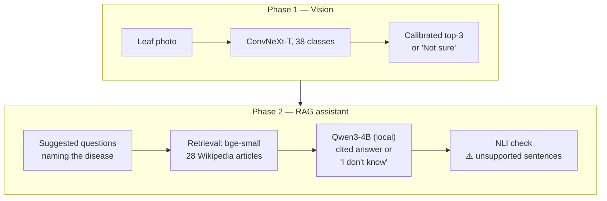
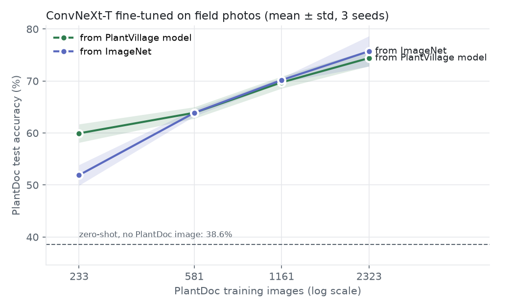
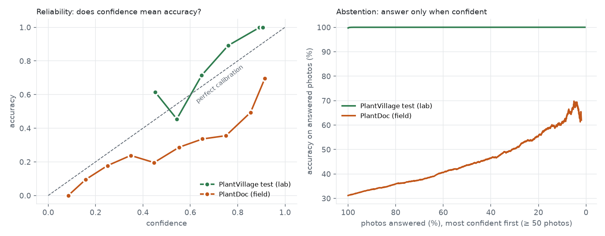

# 🌿 LeafScan

**Diagnose a plant disease from a leaf photo, then ask questions about it to an assistant that
cites its sources — and measure honestly where both break.**

[](https://github.com/marconcini/leafscan/actions/workflows/ci.yml)


[](https://huggingface.co/spaces/Marconcini/leafscan)
[](https://huggingface.co/Marconcini/leafscan-convnext-tiny)


## In two minutes

A student research project in two phases, each run like a small study: **hypotheses written
before the experiments**, a dev/test split for every decision, confidence intervals, and a
[research log](docs/research-log.md) that keeps the negative results.



**What I found**

| | Finding | Number |
|---|---|---|
| Vision | Lab accuracy says nothing about real photos | **99.7%** on PlantVillage → **31%** on field photos (PlantDoc) |
| | A little field data beats a lot of lab data | 233 field photos: 39% → **60%**; all 2,323: **74–76%** |
| | Grad-CAM suggested a background shortcut; a causal test ruled it out | background-only images: chance level (1–5%) |
| | Confidence calibrated in the lab breaks in the field | lab threshold: 99.9% right in the lab, **56%** in the field |
| RAG | Evaluating on synthetic questions would have picked the wrong retriever | BM25 recall@5: **0.96** on copied wording, **0.58** on grower wording (dense: 0.81) |
| | Tuning that won on dev did not hold on test | reranking: +4 grower questions on dev, −1 on test → kept the simple pipeline |
| | The model knows when it doesn't know; extra safety nets don't pay | abstains on **86%** of unanswerable questions; gate / NLI filter: 1 more question caught for ~10% of answers lost |
| | Answers are mostly grounded, not always | **78%** of cited sentences entailed by their source (NLI), ~12% real embellishments |
| Both | Letting the diagnosis steer retrieval hurts | filtering on the predicted disease: **−16 points** of recall@5 (a wrong diagnosis removes the answer) |

**What it shows about how I work**: leak-free splits checked by tests, statistical tests instead
of eyeballing (McNemar, bootstrap CIs), sanity checks before trusting a metric (random-weights
Grad-CAM, NLI on random chunks), licences respected (the PlantVillage website is not scraped:
its robots.txt asks AI crawlers not to), and results reported even when they refute the
hypothesis. 83 unit tests, CI on every push.

**Try it**: 👉 [in-browser demo](https://huggingface.co/spaces/Marconcini/leafscan) (vision only,
nothing uploaded) · [model on the Hub](https://huggingface.co/Marconcini/leafscan-convnext-tiny) ·
full app with the assistant: [run it locally](#demo).

---

# Phase 1 — Vision

## Data

[PlantVillage](https://github.com/spMohanty/PlantVillage-Dataset) (color version, CC BY-SA 3.0):
54,305 leaf images, 14 crops, 38 classes, loaded from the
[Hugging Face Hub](https://huggingface.co/datasets/mohanty/PlantVillage).

**Avoiding data leakage.** Each physical leaf was photographed ~4 times. A naive random split puts
photos of the *same leaf* in both train and validation, which inflates scores. LeafScan:

- uses the **official test split** (10,709 images) for final results only;
- builds the validation set with a **group split by physical leaf**, using the dataset's
  `leaf-map.json` (0 leaves shared between train and validation, checked by a unit test).

| Split | Images |
|---|---|
| Train | 39,251 |
| Validation | 4,345 |
| Test (official) | 10,709 |

## Results

Official PlantVillage test split (10,709 images, never used for model selection).
Same recipe for every model (5 epochs, batch 64, same augmentations and seed; only the
learning rate differs). Latency: 1 image on an Apple M-series CPU; throughput: batch 64 on its GPU (MPS).

| Model | Params | GFLOPs | Size | Accuracy | Macro-F1 | Errors | CPU latency | GPU throughput |
|---|---:|---:|---:|---:|---:|---:|---:|---:|
| EfficientNet-B0 | 4.1M | 0.8 | 16 MB | 99.65% | 99.46% | 38 | 291 ms | 664 img/s |
| ViT-S/16 | 21.7M | 8.5 | 83 MB | **99.73%** | 99.59% | 29 | 29 ms | 810 img/s |
| ResNet-50 | 23.6M | 8.2 | 90 MB | 99.44% | 99.20% | 60 | 25 ms | 570 img/s |
| ConvNeXt-T | 27.8M | 8.9 | 106 MB | 99.71% | 99.55% | 31 | 435 ms | 420 img/s |

**Takeaways**

- **Architecture barely matters on lab images.** All four models are within 0.3 points.
  An exact McNemar test finds **no significant difference between ViT-S, ConvNeXt-T and
  EfficientNet-B0** (p > 0.18); only ResNet-50 is significantly worse (p < 0.004, still
  significant after Bonferroni correction).
- **Fewer FLOPs ≠ faster.** EfficientNet-B0 needs 10× fewer FLOPs than ResNet-50 but is 11×
  slower on this CPU: the PyTorch macOS build has no oneDNN, and the depthwise convolutions
  used by EfficientNet and ConvNeXt fall back to slow kernels. ViT-S is the most accurate *and*
  among the fastest here.
- **Models fail on different images** (pairwise Jaccard overlap of errors 0.17–0.41): 94 images
  fooled at least one model, only 8 fooled all four. Among those 8, two are **dataset errors**
  (a photo of rotten pepper *fruits* labelled "healthy pepper leaf", an empty background labelled
  "healthy soybean") and five are corn leaves with ambiguous lesions.


<sub>Y-axis zoomed: the whole range is 0.3 points.</sub>

Images misclassified by all four models (label / most frequent prediction):


### Where do the models look?

Grad-CAM on the whole test set, compared with leaf masks taken from PlantVillage's
background-removed images. *Leaf focus* = share of the Grad-CAM mass on the leaf
(leaf area = 56.5% on average); *pointing game* = the map's maximum is on the leaf.

| Model | Leaf focus | Pointing game | Random weights (focus / pointing) |
|---|---:|---:|---:|
| ResNet-50 | 88.2% | 98.8% | 58.5% / 44.8% |
| EfficientNet-B0 | 77.1% | 95.6% | 63.7% / 80.4% |
| ConvNeXt-T | 73.9% | 88.7% | 54.9% / 46.7% |
| ViT-S/16 | 68.8% | 67.9% | 35.3% / 32.2% |

- All models mostly look at the leaf, but 12–31% of the attention lands on the background.
- **The most accurate models look the least at the leaf.** On tomato bacterial spot, ConvNeXt-T
  often focuses on the background, yet gets all 436 test images right — a possible shortcut —
  which the causal test below rules out.
- The random-weights baseline [Adebayo et al. 2018] matters: an *untrained* EfficientNet-B0
  already points at the leaf 80% of the time.


### Do they *use* the background? A causal test

Grad-CAM only shows where the map is hot. To test whether the background changes the
prediction, test images are edited with the leaf masks (balanced accuracy, chance = 2.6%):


| Model | Original | Leaf only | Background only (box) | Swapped background: follows leaf / background |
|---|---:|---:|---:|---:|
| ViT-S/16 | 99.6% | **97.7%** | 3.3% | 96.6% / 0.3% |
| ResNet-50 | 99.1% | 95.8% | 3.0% | 97.6% / 0.2% |
| ConvNeXt-T | 99.5% | 94.6% | 4.8% | 97.1% / 0.4% |
| EfficientNet-B0 | 99.4% | 84.5% | 1.4% | 91.6% / 1.3% |

- **No model really uses the background**: background-only images are at chance level, and with
  a swapped background, predictions follow the leaf. The Grad-CAM suspicion about ConvNeXt-T and
  ViT-S was a false alarm.
- **Two artefacts almost said the opposite**: the grey hole revealed the leaf *silhouette* (ViT-S
  20% → 0.7% once hidden), and on blank images models answer one default class (ResNet-50 looked
  like 10.8% "accurate" this way).
- EfficientNet-B0 is the most **disturbed** by a changed background (−15 points), without
  following it: a robustness issue to keep in mind for real field photos.

### Lab → field: the number that matters

Zero-shot evaluation on [PlantDoc](https://github.com/pratikkayal/PlantDoc-Dataset)
(Singh et al., 2020, CC BY 4.0): 2,551 web and field photos after removing duplicates
(including 9 groups of identical images filed under *different* classes).

| Model | PlantVillage (lab) | PlantDoc (field) | Right crop | Healthy vs diseased |
|---|---:|---:|---:|---:|
| ConvNeXt-T | 99.7% | **31.2%** | **58.8%** | 79.7% |
| ViT-S/16 | 99.7% | 29.7% | 51.4% | **80.0%** |
| ResNet-50 | 99.4% | 27.0% | 47.6% | 78.4% |
| EfficientNet-B0 | 99.6% | 23.4% | 44.9% | 75.7% |

- **99.7% in the lab becomes ~30% on real photos.** Even the plant species is wrong about half
  the time; healthy vs diseased (76–80%) barely beats always answering "diseased" (66.8%).
- Tomato bacterial spot: 100% in the lab, **1%** in the field (ConvNeXt-T).
- On unfamiliar images, models fall back on a few default classes (ConvNeXt-T answers "tomato
  late blight" for 25% of PlantDoc images).
- Field errors come with low confidence (only 2–4% above 0.9) — a signal to abstain on.
- What predicted the ranking was the background-*change* test, not lab accuracy.

**Closing the gap with a little field data.** ConvNeXt-T fine-tuned on PlantDoc's training
images, evaluated on its test split (228 images, 3 seeds):



- **233 field images: 38.6% → 59.9%**, more than all 39,251 lab images could give.
- All 2,323: **74–76%**, and still rising (~5 points per doubling).
- Starting from the PlantVillage model only helps with very little field data (+8 points at
  233 images, consistent over seeds); from 581 images on, ImageNet weights do as well.

### Can it say "I don't know"? In the lab, yes. In the field, no.



| | Lab (PlantVillage) | Field (PlantDoc) |
|---|---|---|
| Calibration error (ECE), ConvNeXt-T | 0.098 → **0.001** after temperature scaling | 0.240 → **0.487** with the same temperature |
| Answer only if confidence ≥ lab threshold | 98.8% answered, 99.96% right | 19.7% answered, **56%** right |
| Reject flowers / textures (AUROC) | 0.999 / 0.999 | 0.83 / 0.90 |

- Models are *under*confident in the lab (label smoothing) and *over*confident in the field; a
  temperature fitted in the lab doubles the field calibration error.
- A confidence threshold that guarantees 99.9% in the lab gives ~50% in the field.
- Rejecting non-leaf photos is trivial next to lab leaves, unreliable next to field leaves.
- **Lesson: reliability measured in the lab says nothing about the field.**

Details per model in [`reports/`](reports) · full analysis in the [research log](docs/research-log.md).

> Lab scores above are on PlantVillage images with uniform backgrounds; see
> [Lab → field](#lab--field-the-number-that-matters) for real photos.

# Phase 2 — RAG assistant

Given the diagnosis, answer the grower's questions from a fixed corpus, **citing sources**, and
say "I don't know" when the corpus does not answer. Every step below has a plan written before
its results in the [research log](docs/research-log.md).

### Corpus: what we may reuse decides what we can answer

28 English Wikipedia articles (CC BY-SA 4.0, pinned by revision id) covering the 26 disease
classes, split into **240 section-aware chunks** of ≤ 200 words. The PlantVillage website was
excluded (its robots.txt blocks AI crawlers), extension-service fact sheets are copyrighted.
The price: coverage is uneven (grape leaf blight has 24 words; 4 diseases have no management
section), and the assistant can only be as good as this.

### Evaluation set: 111 questions, three kinds

| Type | n | What it tests | Words shared with the evidence |
|---|---:|---|---:|
| Extractive | 44 | written from the passage, reusing its wording | 46% |
| Grower-style | 43 | how a grower would ask ("brown rings on my tomato leaves…") | 15% |
| Unanswerable | 24 | plausible, but the corpus does not answer | – |

Gold labels are **quotes**, not chunk ids, so they stay valid for any chunking. 40% dev (all
tuning), 60% test (reported), stratified by type. Limitation: all questions are LLM-written;
a human-written subset is the main open item.

### Retrieval: the wording gap decides

Recall@5 on the test split (relevant chunk in the top 5):

| Retriever | All | Extractive | Grower |
|---|---:|---:|---:|
| BM25 | 0.77 | **0.96** | 0.58 |
| all-MiniLM-L6-v2 | 0.71 | 0.81 | 0.62 |
| **bge-small-en-v1.5** (kept) | **0.85** | 0.88 | **0.81** |
| bge-m3 (568M) | 0.85 | 0.92 | 0.77 |

- BM25 loses 31 points more than bge-small when growers rephrase (95% CI 8–54): an evaluation
  on extractive questions alone would have chosen it.
- Hybrid search (RRF), stemming, chunk size and cross-encoder reranking were tested on dev.
  The best pipeline gained 4 grower questions on dev and **lost** one on test: with 17 dev
  questions per type, that is the winner's curse. The simplest strong system was kept.

### Grounded generation: abstains well, embellishes a little

Qwen3-4B-Instruct (Apache 2.0) runs locally, greedy decoding, top-5 chunks, one citation per
sentence required. Support is checked by an NLI model (DeBERTa-v3-large), validated first:
it entails 92% of gold quotes by their own chunk and 0% by a random chunk.

| Test split | Extractive | Grower | Unanswerable |
|---|---:|---:|---:|
| Says "I don't know" | 8% | 12% | **86%** |
| Cited sentences entailed by their source | 84% | 74% | – |
| Answer cites the gold chunk | 92% | 87% | – |

- Most wrong abstentions (6 of 8, both splits) happen when retrieval missed the answer: the
  model is right not to answer from what it was given.
- A manual review of the 14 sentences the NLI rejected: 6 correct paraphrases, 7 embellishments,
  1 contradiction → about **12%** of answer sentences add something the source does not say, mostly in grower answers.

**Two extra safety nets** (a similarity gate on retrieval, an NLI filter on sentences) each
catch **one** more unanswerable question and cost ~10% of the good answers. Not adopted: the
app **flags** unsupported sentences with ⚠️ instead of hiding them. The two remaining failures
(e.g. "can I eat potatoes after late blight?") are built from true facts on a question the corpus
never addresses, which sentence-level checks cannot see.

### Vision ↔ RAG: the diagnosis should not steer retrieval

Simulated on 500 (question, field photo) pairs with the classifier's real outputs on PlantDoc
test photos (recall@5, test):

| Retrieval | Recall@5 |
|---|---:|
| **Question as written** (kept) | **0.83** |
| Filtered to the predicted disease | 0.67 |
| Filtered to the top-2 when the classifier is unsure | 0.74 |
| Predicted disease name prepended to the question | 0.67 |
| Filtered to the true disease (upper bound) | 0.86 |

A right diagnosis adds 8 points; a wrong one (28% of field photos) removes 50–60. Prepending the
disease name hurts even when it is right: it pulls the query toward the page's general
sections. So the diagnosis is shown, and used to **suggest questions that name the disease**
(both candidates when unsure), which the user sees and can correct.

---

## Demo

👉 **[Try it in your browser](https://huggingface.co/spaces/Marconcini/leafscan)** — the model
runs locally in the page (ONNX Runtime Web, int8, 32 MB): no server, nothing is uploaded.
Weights and model card: [Marconcini/leafscan-convnext-tiny](https://huggingface.co/Marconcini/leafscan-convnext-tiny).

The final model: ConvNeXt-T trained on PlantVillage, fine-tuned on PlantDoc field photos, with a
confidence threshold fitted on held-out field photos. A Gradio version (with Grad-CAM) runs
locally:

```bash
pip install -e ".[app]"
python -m leafscan.deploy      # builds models/leafscan_field/best.pt (needs both datasets)
python -m leafscan.app         # http://127.0.0.1:7860
```

- Upload a leaf photo → top-3 diagnoses with calibrated probabilities and a Grad-CAM map.
- Below the field-fitted threshold it answers **"Not sure"** instead of guessing.
- On PlantDoc test photos: **72.4%** right overall; it answers 65% of them, and **87%** of those
  answers are right. Lab photos: 96.6% (99.7% before field fine-tuning).

**With the assistant** (local only: the LLM and NLI models are ~10 GB, ~5 s per answer on a laptop):

```bash
pip install -e ".[app,rag]"
LEAFSCAN_ASSISTANT=1 python -m leafscan.app
```

After the diagnosis, pick a suggested question or type your own: the answer comes with `[n]`
citations, links to the cited Wikipedia sections, and ⚠️ on sentences the NLI check finds
unsupported — a check that misses some inventions, so read the sources before acting.

## Limitations

- **Field accuracy is 72%.** Good enough for a research demo, not for a decision. The model only
  knows 38 classes and will answer one of them for any leaf.
- **The corpus is Wikipedia.** It is uneven, general, and not a substitute for local extension
  advice (products, doses and regulations vary by country).
- **The evaluation set is small and LLM-written** (66 test questions). Differences of a few
  points are within noise; the CIs in the research log say how much.
- **The NLI check has false positives**, especially on questions the corpus does not address.

## Quickstart

```bash
python -m venv .venv && source .venv/bin/activate
pip install -e ".[dev]"

python scripts/download_data.py                      # ~2.2 GB download, color images only kept
python -m leafscan.train --config configs/efficientnet_b0.yaml
python -m leafscan.evaluate models/efficientnet_b0/best.pt
python -m leafscan.benchmark models/*/best.pt         # run on an idle machine
python -m leafscan.compare                             # -> reports/comparison.md / .png

python scripts/download_data.py --segmented           # leaf masks for Grad-CAM
python -m leafscan.explain metrics models/resnet50/best.pt [--random-weights]
python -m leafscan.explain figure models/*/best.pt --images  ... --device cpu
python -m leafscan.background models/convnext_tiny/best.pt

git clone --depth 1 https://github.com/pratikkayal/PlantDoc-Dataset.git data/plantdoc
python -m leafscan.field models/convnext_tiny/best.pt
python -m leafscan.field_finetune --init plantvillage --fraction 0.25 --seed 0
python -m leafscan.field_finetune --summary
python -m leafscan.reliability models/convnext_tiny/best.pt   # needs Flowers-102 & DTD in data/ood
```

```bash
# Phase 2 (pip install -e ".[rag]")
python -m leafscan.rag.corpus stats                    # corpus/wikipedia.jsonl is versioned
python -m leafscan.rag.evalset check
python -m leafscan.rag.retrieval_eval                  # baselines
python -m leafscan.rag.retrieval_experiments --split dev
python -m leafscan.rag.generate --condition retrieved  # local LLM, ~4 s per question
python -m leafscan.rag.attribution                     # NLI support of each sentence
python -m leafscan.rag.abstention
python -m leafscan.rag.diagnosis predict && python -m leafscan.rag.diagnosis evaluate
```

Quick sanity run (a few minutes): `python -m leafscan.train --config configs/efficientnet_b0.yaml --limit-per-class 20 --epochs 1`

Training runs on CUDA, Apple Silicon (MPS) or CPU.

## Project structure

```
src/leafscan/
├── data.py       # download, leak-free splits, dataset & augmentations
├── model.py      # timm backbones, device selection, checkpoints
├── train.py      # fine-tuning loop (AdamW, warmup + cosine, label smoothing)
├── evaluate.py   # accuracy, macro-F1, top-5, per-class report, confusion matrix, errors
├── benchmark.py  # params, FLOPs, size, CPU latency, GPU throughput
├── compare.py    # comparison table & plot, error overlap, McNemar tests
├── gradcam.py    # Grad-CAM for CNNs and ViT, leaf-focus & pointing-game metrics
├── explain.py    # Grad-CAM analysis against leaf masks, example figures
├── background.py # causal test: leaf only, background only, swapped background
├── field.py      # zero-shot evaluation on PlantDoc field photos
├── field_finetune.py # fine-tuning on PlantDoc fractions, two initialisations
├── reliability.py   # calibration (ECE, temperature), abstention, OOD detection
├── deploy.py        # demo model: field fine-tuning + field calibration
├── predictor.py     # inference: calibrated top-k, abstention, Grad-CAM overlay
├── app.py           # Gradio demo
├── export.py        # safetensors export / loading from the Hugging Face Hub
└── onnx_export.py   # ONNX export, int8 quantisation, recalibration
└── rag/
    ├── corpus.py        # Wikipedia snapshot (pinned revisions), section-aware chunking
    ├── evalset.py       # question set checks, quote-based gold labels, dev/test split
    ├── retrieval.py     # BM25, dense, RRF fusion, cross-encoder reranking
    ├── retrieval_eval.py, retrieval_experiments.py
    ├── generate.py      # grounded generation with citations (local LLM)
    ├── attribution.py   # NLI support check of cited sentences
    ├── abstention.py    # retrieval gate and support filter
    ├── diagnosis.py     # using the photo diagnosis in retrieval (simulation)
    └── assistant.py     # the app's assistant: retrieve, answer, flag
corpus/              # the Wikipedia snapshot and its attribution
evaluation/          # the 111 questions
web/index.html       # in-browser demo (ONNX Runtime Web), deployed as a static Space
configs/          # one YAML per compared model
tests/            # unit tests + end-to-end pipeline test on a synthetic dataset
```

## Roadmap

Detailed plan with research questions: [ROADMAP.md](ROADMAP.md) · experiment journal: [docs/research-log.md](docs/research-log.md) · papers: [docs/references.md](docs/references.md)

**Phase 1 — Vision**
- [x] Data pipeline with leak-free validation split
- [x] Training & evaluation pipeline, tests, CI
- [x] Baseline: EfficientNet-B0 (99.65% test accuracy)
- [x] Model comparison: ResNet-50 · ConvNeXt-T · ViT-S (accuracy, F1, latency, size)
- [x] Error analysis + Grad-CAM explanations
- [x] Background bias: causal test with edited backgrounds
- [x] Robustness to real field photos: 99.7% → ~30% on PlantDoc
- [x] Closing the lab → field gap: fine-tuning on PlantDoc, 38.6% → 74–76%
- [x] Calibration, abstention and OOD detection: reliable in the lab, not in the field
- [x] Demo app: field-calibrated model, "Not sure" answers, Grad-CAM
- [x] Public demo: in-browser (ONNX Runtime Web) on Hugging Face Spaces, weights on the Hub

**Phase 2 — RAG assistant**
- [x] Corpus: 28 Wikipedia articles, 240 chunks, licence-checked sources
- [x] Evaluation set: 111 questions, quote-based gold labels, dev/test split
- [x] Retrieval: BM25 vs dense, hybrid, chunk size, reranking
- [x] Grounded generation with citations, NLI support check
- [x] Abstention: the model's own "I don't know" vs retrieval gate and support filter
- [x] Full app: photo → diagnosis → suggested questions → cited answers

**Open**: human-written questions, a question-level "sufficient context" check, more field
data for the classifier. Details in [ROADMAP.md](ROADMAP.md).

## License

Code: MIT. Datasets: PlantVillage (CC BY-SA 3.0); PlantDoc (CC BY 4.0, images not redistributed here).
Corpus: English Wikipedia (CC BY-SA 4.0, attribution in [corpus/README.md](corpus/README.md)).
Models used: Qwen3-4B-Instruct-2507 (Apache 2.0), BAAI/bge-small-en-v1.5 (MIT),
DeBERTa-v3-large NLI by MoritzLaurer (MIT).
